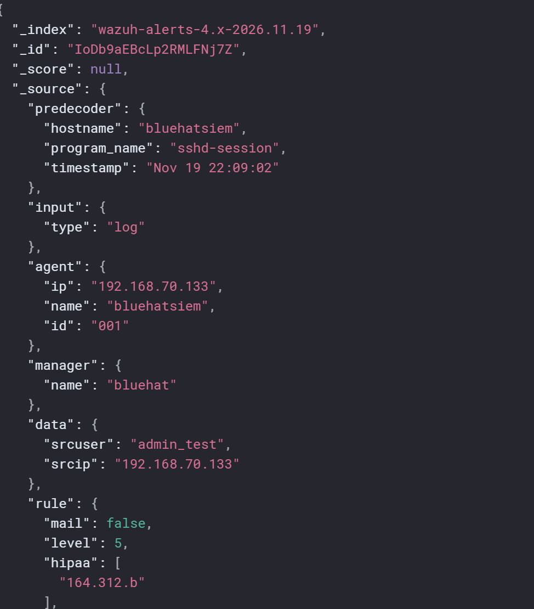
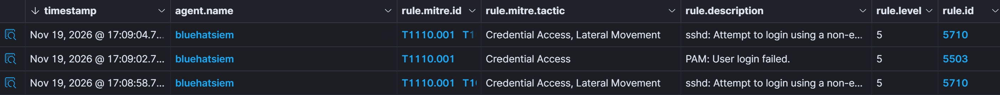
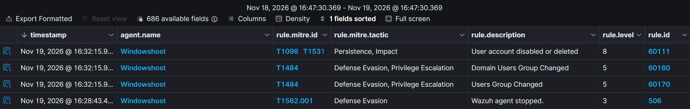
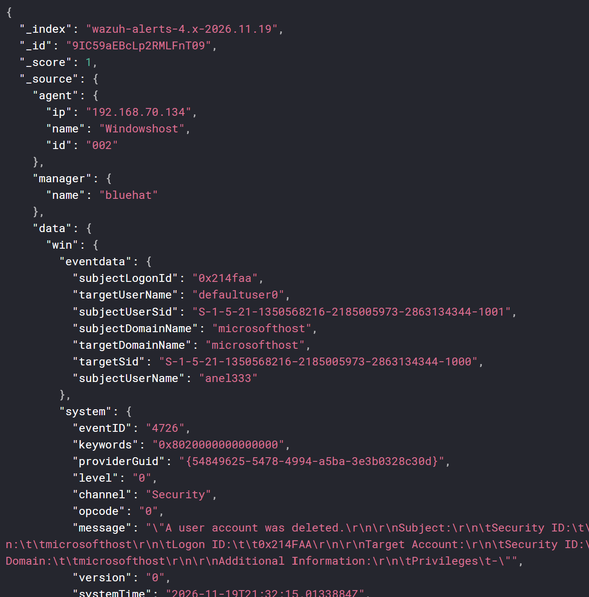

# Multi-Platform SIEM & Endpoint Detection Lab (Wazuh)

## Overview
This project demonstrates the end-to-end deployment, configuration, and operational use of an open-source **Wazuh SIEM/XDR** environment across a segmented virtualized network. The lab centralizes log ingestion from both **Windows 11** and **Ubuntu Linux** endpoints to detect, correlate, and investigate host-based security events mapped to the **MITRE ATT&CK** framework.

---

## Lab Architecture

```text
+-------------------------------------------------------------------+

|                     Host Machine (VMware Workstation)             |
|                                                                   |
|   +-----------------------+           +-----------------------+   |
|   |   Windows 11 Endpoint |           |    Ubuntu Endpoint    |   |
|   |     (Windowshost)     |           |     (bluehatsiem)     |   |
|   |  - Windows Event Logs |           |  - /var/log/auth.log  |   |
|   |  - Wazuh Agent 4.14   |           |  - Wazuh Agent 4.14   |   |
|   +-----------+-----------+           +-----------+-----------+   |
|               |                                   |               |
|               |   TCP 1514 (Logs) / 1515 (Auth)   |               |
|               +-----------------+-----------------+               |
|                                 |                                 |
|                                 v                                 |
|               +-----------------------------------+               |
|               |       Wazuh SIEM Server           |               |
|               |        (Ubuntu Server)            |               |
|               |  - Wazuh Manager & Rule Engine    |               |
|               |  - Wazuh Indexer (OpenSearch)     |               |
|               |  - Wazuh Dashboard (Kibana UI)    |               |
|               +-----------------------------------+               |
+-------------------------------------------------------------------+
```

### Environment Components
* **SIEM Server:** Ubuntu Server hosting Wazuh Manager, Wazuh Indexer, and Wazuh Dashboard (`v4.14.x`).
* **Windows Endpoint:** Windows 11 x64 (`Windowshost`) shipping Security Event Channel telemetry.
* **Linux Endpoint:** Ubuntu (`bluehatsiem`) shipping `sshd`, `PAM`, and system authentication logs.
* **Virtualization & Networking:** VMware Workstation virtual network with isolated host-to-manager communication over TCP ports `1514` and `1515`.

---

## Detection & Triage Demonstrations

### 1. Linux SSH Brute-Force & Credential Enumeration (`MITRE T1110.001` / `T1021.004`)
* **Objective:** Simulate an external credential guessing attack against an Ubuntu endpoint to validate multi-service log correlation (`sshd` + `PAM`).
* **Simulation:** Executed repeated automated SSH authentication attempts against a non-existent user (`admin_test`) from a remote lab host:
  ```bash
  for i in {1..8}; do ssh -o BatchMode=yes -o ConnectTimeout=2 admin_test@<UBUNTU_ENDPOINT_IP>; done
  ```
* **Detection & Telemetry:**
  * **Rule `5710` (Level 5):** *sshd: Attempt to login using a non-existent user*
  * **Rule `5503` (Level 5):** *PAM: User login failed*
  * **Parsed IOCs:** Extracted `data.srcip` (source attacker IP), `data.srcuser` (`admin_test`), and mapped compliance controls (`PCI-DSS`, `HIPAA`).
* * **Alert Evidence:**
  * 
  * 

* **Remediation & Defense:**
  * Enforce SSH key-based authentication (`PasswordAuthentication no` in `/etc/ssh/sshd_config`).
  * Enable Wazuh **Active Response** (`firewall-drop`) on brute-force threshold rules to automatically block offending source IPs at the host firewall.

---

### 2. Windows Account Lifecycle & Privilege Monitoring (`MITRE T1098` / `T1531`)
* **Objective:** Monitor Windows Security Event IDs (`4720`, `4726`, `4732`) to detect unauthorized account creation, group modification, or account deletion—and practice SOC false-positive triage.
* **Detection & Telemetry:**
  * **Rule `60111` (Level 8):** *User account disabled or deleted* (Windows Security **Event ID `4726`**)
  * **Rule `60160` / `60170`:** *Domain Users / Users Group Changed*
* **SOC Triage Analysis:**
  * Inspecting the parsed event payload (`win.eventdata.targetUserName`) revealed that the deleted account was `defaultuser0`—a built-in temporary provisioning account automatically removed by Windows 11 following initial Out-of-Box Experience (OOBE) setup.
  * Documented as **Benign True Positive / Expected Provisioning Activity**, demonstrating how field-level JSON inspection prevents unnecessary alert escalation.
* * **Alert Evidence:**
  * 
  * 

* **Remediation & Defense:**
  * Restrict local Administrator group membership via Group Policy / Least Privilege.
  * Configure custom child rules in `local_rules.xml` to suppress expected `defaultuser0` cleanup events while escalating any non-standard local account additions (`Event ID 4720`) to Level 12+.

---

## Repository Structure

```text
wazuh-siem-lab/
├── README.md
├── .gitignore
├── configs/
│   ├── manager-ossec.conf         # Sanitized Wazuh Manager configuration
│   ├── ubuntu-agent-ossec.conf    # Sanitized Ubuntu endpoint agent configuration
│   └── windows-agent-ossec.conf   # Sanitized Windows 11 endpoint agent configuration
└── images/
    ├── ubuntu-ssh-bruteforce.png
    ├── ubuntu-ssh-json.png
    ├── windows-account-alert.png
    └── windows-account-json.png
```

---

## Key Challenges & Lessons Learned
* **VM Provisioning & Isolation:** Bypassed Windows 11 OOBE network stalls and configured local administrative accounts to maintain an isolated, repeatable lab baseline.
* **Cross-Platform Log Ingestion:** Resolved Windows PowerShell vs. Command Prompt MSI deployment syntax and verified TCP `1514`/`1515` connectivity across virtual subnets.
* **Configuration Hygiene:** Sanitized all exported `ossec.conf` files and excluded agent registration keys (`client.keys`) and certificates prior to version control.
